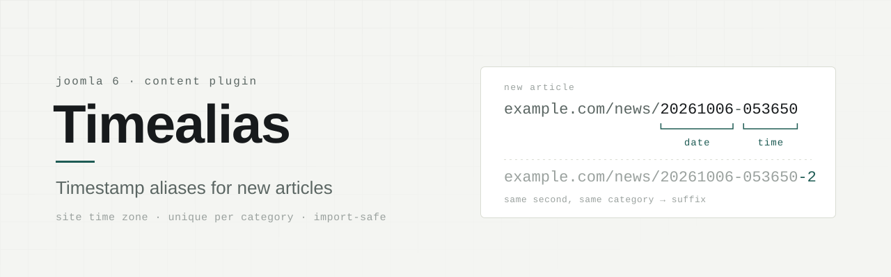

<p align="center">
  <picture>
    <source media="(prefers-color-scheme: dark)" srcset="docs/banner-dark.svg">
    
  </picture>
</p>

<p align="center"><a href="README.md">English</a> · <strong>Русский</strong></p>

<p align="center">
  <a href="https://github.com/bsakhanov/plg_content_timealias/releases/latest"></a>
  
  
  <a href="LICENSE"></a>
  <a href="https://github.com/bsakhanov/plg_content_timealias/releases"></a>
</p>

# Timealias

Плагин группы `content` для Joomla 6. Каждому новому материалу он присваивает алиас вида `ГГГГММДД-ЧЧММСС` — например, `20261006-053650` — по часовому поясу сайта.

Адреса статей получаются короткими, одинаковыми по форме и не зависят от заголовка: его можно сколько угодно править после публикации, ссылка останется прежней. Заголовок на любом алфавите, кириллица в том числе, даёт один и тот же чистый адрес.

## Как работает

- **Только при создании.** Правка существующей статьи алиас не трогает. «Сохранить как копию» создаёт новый материал, и копия получает свежую метку, а не алиас оригинала.
- **Время сайта, а не сервера.** Метка берётся по настройке *Система → Общие настройки → Сервер → Часовой пояс сайта*, а не по часам сервера, которые обычно идут по UTC.
- **Без столкновений.** Ядро Joomla требует, чтобы алиас был уникален в пределах категории, и отказывается сохранять дубликат. Если две статьи созданы в одну секунду в одной категории, вторая получит `-2`, третья — `-3` и т. д. Учитываются и материалы в корзине.
- **Все пути создания.** Обрабатываются материалы из админки, через REST API и через форму на сайте. Категории, пункты меню и другие компоненты плагин не затрагивает.
- **Заданный алиас — главнее.** Алиас, вписанный вручную или пришедший при импорте, по умолчанию сохраняется: метка ставится, только когда поле оставлено пустым. Это поведение отключается в настройках плагина.

## Импорт старых статей

Статьи, которые уже лежат на сайте, плагин не трогает. При импорте всё зависит от того, как импортёр сохраняет статьи:

- **Через модель Joomla или REST API** — плагин видит их как новые. Если импортёр передаёт старый алиас, он сохраняется, и прежние адреса не ломаются; если алиаса нет, ставится метка времени.
- **Прямой записью в базу** (SQL-дамп, запись в таблицу в обход модели) — плагин вообще не вызывается, алиасы остаются как были.

Самый осторожный путь для большой миграции — выключить плагин на время импорта.

Почему плагин смотрит на исходный запрос: при сохранении из формы и через API ядро само подставляет в пустое поле алиаса транслит заголовка — *раньше*, чем срабатывает плагин. Чтобы отличить пустое поле от заполненного, плагин читает то, что пришло на самом деле: поле формы `jform[alias]`, тело запроса API или данные, переданные модели напрямую.

## Установка

Нужный архив — в [Releases](https://github.com/bsakhanov/plg_content_timealias/releases/latest).

**Через установщик** — `plg_content_timealias_<версия>.zip`

1. *Система → Установка → Расширения*, загрузите архив.
2. Включите «Материалы — Timealias» в *Система → Управление → Плагины*.

**Распаковкой в корень сайта** — `plg_content_timealias_<версия>_site-root.zip`. Удобно через FTP или файловый менеджер хостинга, без загрузки через админку.

1. Распакуйте архив в корень Joomla; файлы лягут в `plugins/content/timealias/`.
2. *Система → Установка → Обнаружить*, отметьте «Материалы — Timealias», нажмите «Установить».
3. Включите плагин в *Система → Управление → Плагины*.

Архив *Source code (zip)*, который GitHub прикладывает к каждому релизу, тоже ставится через установщик: Joomla копирует из него только файлы, перечисленные в манифесте.

## Настройки

| Параметр | По умолчанию | Действие |
|---|---|---|
| Сохранять заданный алиас | Да | «Да» — метка ставится, только когда поле алиаса пустое. «Нет» — метку получает любой новый материал, что бы ни было в поле. |

## Требования

Joomla 6.x, PHP 8.3 и новее. Проверено на Joomla 6.1.4 с PHP 8.3 и MariaDB 10.11.

## Сборка из исходников

```bash
./build.sh
# dist/plg_content_timealias_<версия>.zip            — пакет для установщика
# dist/plg_content_timealias_<версия>_site-root.zip  — архив для корня сайта
```

Версия берётся из `timealias.xml` — менять её нужно только там.

## Лицензия

[GNU General Public License версии 2 или более поздней](LICENSE).

© 2026 Бейбит Саханов · [webmarka.kz](https://webmarka.kz)
